# Theme Previews

Every theme rendered from the same [`sample.md`](sample.md). Click a thumbnail for the full PDF.

## Plugin themes

| | | |
|---|---|---|
| [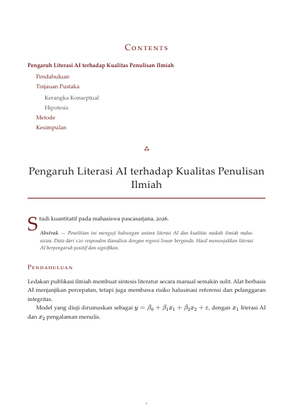](academic.pdf)<br>**academic** — thesis / report | [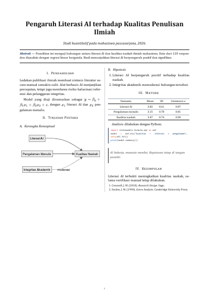](jurnal.pdf)<br>**jurnal** — two-column paper | [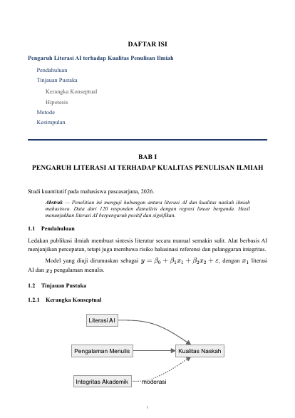](tugas-kuliah.pdf)<br>**tugas-kuliah** — laporan kampus |
| [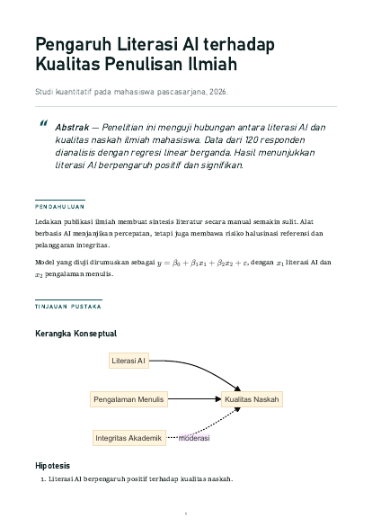](artikel.pdf)<br>**artikel** — magazine long-form | [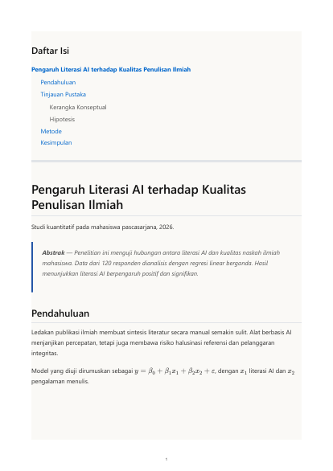](catatan-buku.pdf)<br>**catatan-buku** — notes | [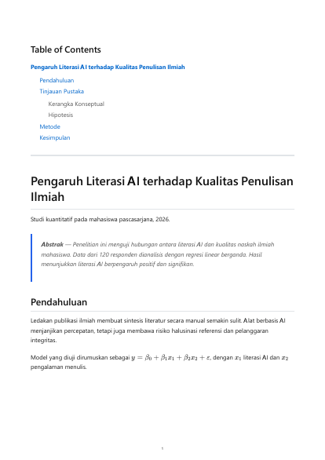](default.pdf)<br>**default** |
| [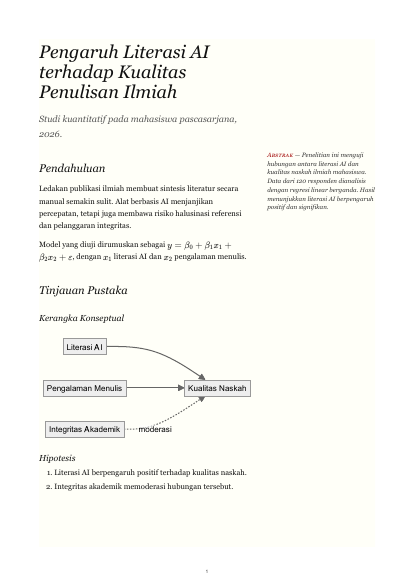](tufte.pdf)<br>**tufte** — lecture notes, sidenotes | [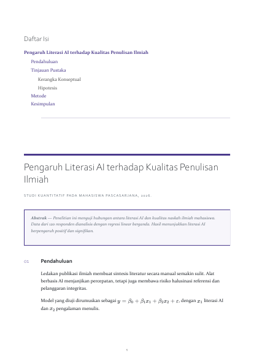](proposal.pdf)<br>**proposal** — research / grant | [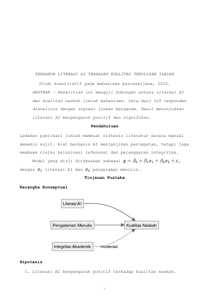](naskah.pdf)<br>**naskah** — submission manuscript |
| [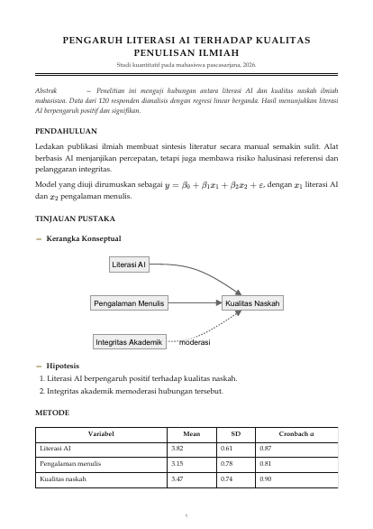](surat-dinas.pdf)<br>**surat-dinas** — official letter | [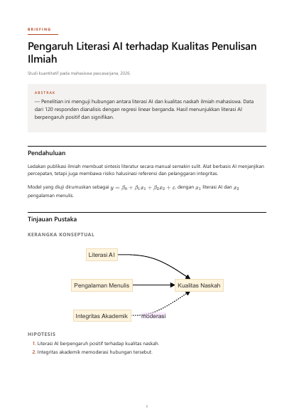](memo.pdf)<br>**memo** — executive briefing | [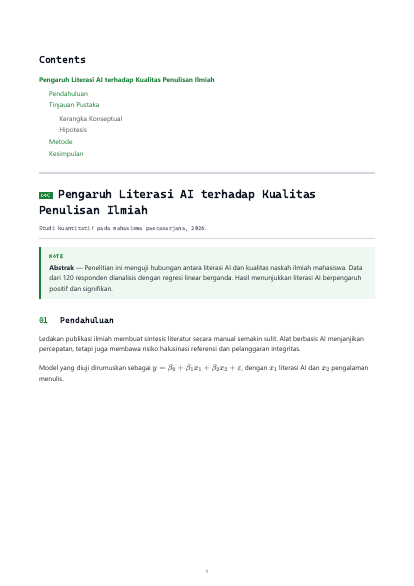](teknis.pdf)<br>**teknis** — technical docs / SOP |
| [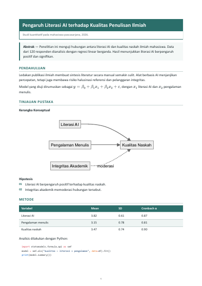](notulen.pdf)<br>**notulen** — meeting minutes | [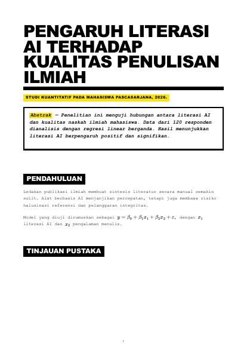](zine.pdf)<br>**zine** — brutalist essay | |

## md2pdf built-in themes

| | | |
|---|---|---|
| [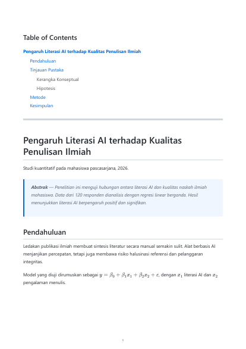](github.pdf)<br>**github** | [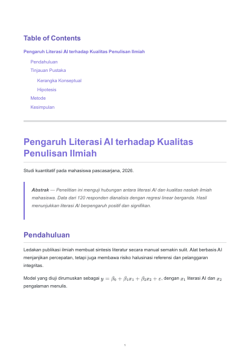](obsidian-light.pdf)<br>**obsidian-light** | [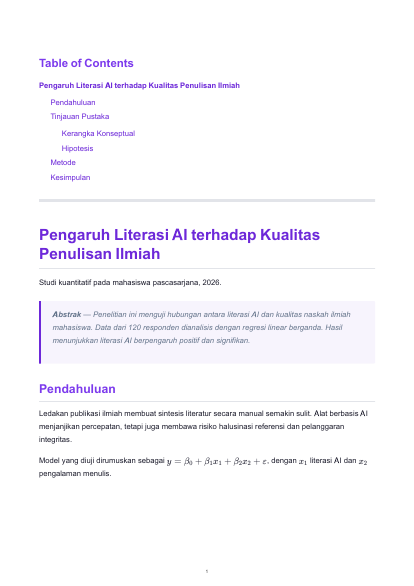](obsidian-dark.pdf)<br>**obsidian-dark** |
| [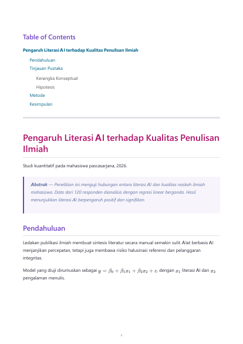](dracula.pdf)<br>**dracula** | [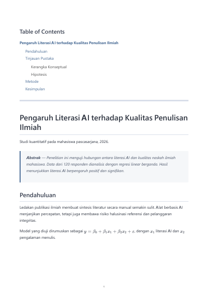](nord.pdf)<br>**nord** | |

The built-in "dark" themes use a white page in print by design; only accents change.

## Regenerate

```bash
node previews/build.cjs
```

Thumbnails need poppler's `pdftoppm` on `PATH`; without it only PDFs are rebuilt.
