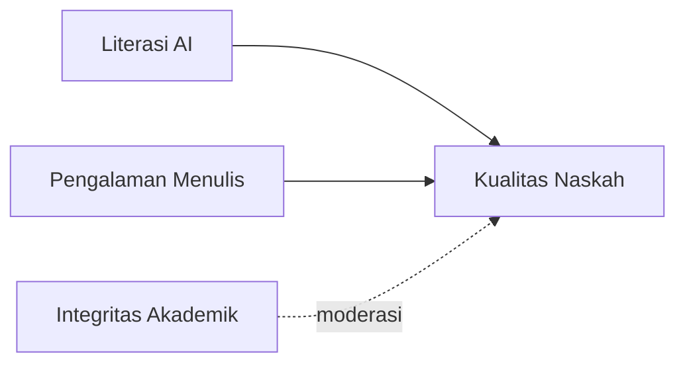

# Pengaruh Literasi AI terhadap Kualitas Penulisan Ilmiah

Studi kuantitatif pada mahasiswa pascasarjana, 2026.

> **Abstrak** — Penelitian ini menguji hubungan antara literasi AI dan kualitas naskah ilmiah mahasiswa. Data dari 120 responden dianalisis dengan regresi linear berganda. Hasil menunjukkan literasi AI berpengaruh positif dan signifikan.

## Pendahuluan

Ledakan publikasi ilmiah membuat sintesis literatur secara manual semakin sulit. Alat berbasis AI menjanjikan percepatan, tetapi juga membawa risiko halusinasi referensi dan pelanggaran integritas.

Model yang diuji dirumuskan sebagai $y = \beta_0 + \beta_1 x_1 + \beta_2 x_2 + \varepsilon$, dengan $x_1$ literasi AI dan $x_2$ pengalaman menulis.

## Tinjauan Pustaka

### Kerangka Konseptual



### Hipotesis

1. Literasi AI berpengaruh positif terhadap kualitas naskah.
2. Integritas akademik memoderasi hubungan tersebut.

## Metode

| Variabel | Mean | SD | Cronbach α |
|---|---|---|---|
| Literasi AI | 3.82 | 0.61 | 0.87 |
| Pengalaman menulis | 3.15 | 0.78 | 0.81 |
| Kualitas naskah | 3.47 | 0.74 | 0.90 |

Analisis dilakukan dengan Python:

```python
import statsmodels.formula.api as smf
model = smf.ols("kualitas ~ literasi + pengalaman", data=df).fit()
print(model.summary())
```

> AI bekerja, manusia menilai. Keputusan tetap di tangan peneliti.

## Kesimpulan

Literasi AI terbukti meningkatkan kualitas naskah, selama verifikasi manual tetap dilakukan.

1. Creswell, J. W. (2018). *Research Design*. Sage.
2. Swales, J. M. (1990). *Genre Analysis*. Cambridge University Press.
