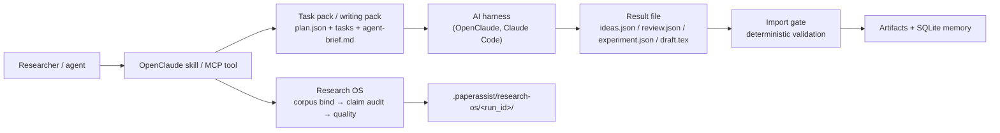
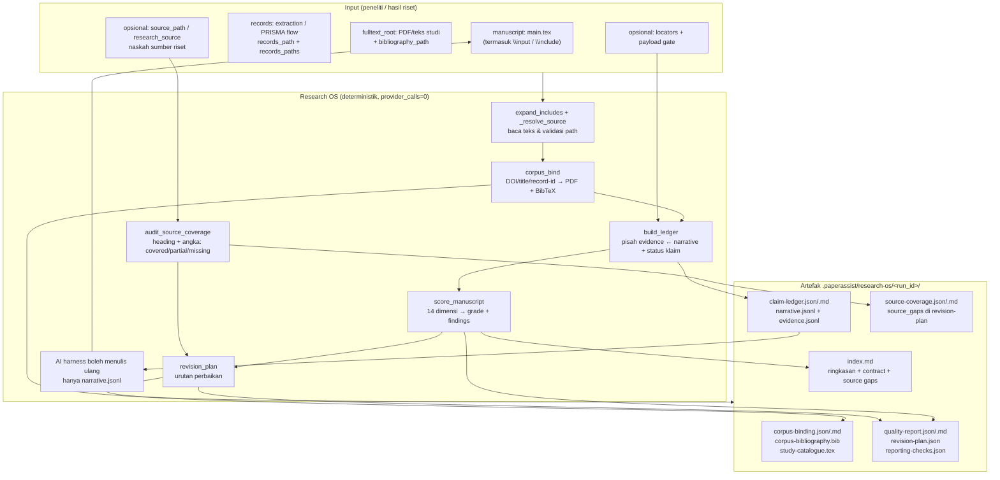

# PaperAssist

<p align="center">
  
  
</p>

PaperAssist is a model-free research runtime and an OpenClaude / Claude Code
plugin. It plans research, defines controlled experiments, prepares LaTeX
writing tasks, reviews manuscripts and verifies releases — while **the only
language model is the AI harness you already run**. PaperAssist ships no
provider client, no API key handling and no model selection.

> ⚠️ Disclaimer: this project is for learning and research. Do not use it
> commercially. You are responsible for anything you produce with it.

## Contents

- [What changed in v4](#what-changed-in-v4)
- [How it works](#how-it-works)
- [Install](#install)
- [Using the plugin](#using-the-plugin)
- [Writing a paper: AI Harness &rarr; Paper-Assist](#writing-a-paper-ai-harness--paper-assist)
- [Research OS pipeline](#research-os-pipeline)
- [Skills included](#skills-included)
- [Workspace layout](#workspace-layout)
- [Scientific integrity](#scientific-integrity)
- [License](#license)

## What changed in v4

| Area | v3 | v4 |
|---|---|---|
| Language model | Bundled OpenAI-compatible client, provider registry, credentials | None. The AI harness is the executor (`provider_calls: 0`) |
| Generation | In-process agent runtime called the model | Deterministic task packs the harness executes |
| Integration | Custom CLI only | OpenClaude plugin with skills and an MCP server |
| Runtime | `ResearchOSRuntime` orchestrated agents | Pack → harness → import gate *is* the runtime |
| Package | `paperforge` | `paperassist` |

## How it works



PaperAssist never generates text. It owns:

- **Planning**: packs, task lists, briefs, acceptance rules.
- **Binding**: protected experiment blocks, citations, dan korpus penelitian (PDF + records + bibliography).
- **Verification**: citation keys, score ranges, artifact hashes, release gates.
- **Audit naskah**: claim ledger, kanal narasi vs bukti, kualitas manuskrip, dan source-coverage untuk SLR/review.

## Install

### Claude Code (marketplace)

Repo ini sekaligus marketplace `mahdyarief`, jadi plugin terpasang sebagai
`paper-assist@mahdyarief`:

```text
/plugin marketplace add mahdyarief/paper-assist
/plugin install paper-assist@mahdyarief
```

Atau dalam satu langkah (Claude Code 2.1.275+):

```text
/plugin install paper-assist --marketplace mahdyarief/paper-assist
```

Dari shell: `claude plugin marketplace add mahdyarief/paper-assist` lalu
`claude plugin install paper-assist@mahdyarief`. Untuk menguji salinan lokal,
ganti `mahdyarief/paper-assist` dengan path folder repo ini.

### OpenClaude

Clone ke direktori plugin user OpenClaude:

```bash
git clone https://github.com/mahdyarief/paper-assist.git ~/.openclaude/plugins/paper-assist
```

### Kebutuhan

Hanya Python 3.10+ di `PATH` sebagai `python`; runtime dan MCP server memakai
standard library saja, jadi tidak perlu `pip install`. Opsional, untuk
ekstraksi teks PDF referensi:

```bash
python -m pip install -r requirements.txt
```

Verifikasi: panggil tool `harness_status`, atau jalankan
`python mcp_servers/stdio.py` dan kirim request JSON-RPC `initialize`.

## Using the plugin

Plugin ini dideklarasikan oleh `.claude-plugin/plugin.json`. Skill dibaca
dari `skills/`, dan MCP server `paperassist` berada di
`mcp_servers/stdio.py` (JSON-RPC over stdio).

MCP tools (18):

| Group | Tools |
|---|---|
| `paperassist` (planning & packs) | `harness_status`, `pack_scaffold`, `pack_plan`, `pack_task`, `pack_import` |
| `paperassist` (Research OS) | `corpus_bind`, `claim_audit`, `quality_score`, `research_os`, `improvement_verify`, `journal_lookup`, `thesis_lookup`, `design_lookup` |
| `writing` | `writing_pack`, `writing_plan`, `writing_task`, `writing_import`, `writing_patch` |

Setiap tool mengiklankan `inputSchema` lengkap (nama, tipe, default, wajib),
dan argumen yang tidak dikenal ditolak dengan daftar argumen yang diterima.
Kegagalan eksekusi dikembalikan sebagai hasil `isError: true` agar harness
bisa membaca pesannya dan memperbaiki panggilan.

Resources dibaca lewat `resources/read`; parameter per-run dikirim sebagai
query string, mis. `paperassist://pack?workspace=<ws>&kind=review&run_id=<id>`,
`writing://brief?workspace=<ws>&run_id=<id>`, atau
`paperassist://journal-profiles?scope=indonesia`.

`journal_lookup` returns curated, citable format references (Indonesian
SINTA/JTIM and international Elsevier/IEEE/Springer/ACM), or detects plausible
profiles from a manuscript's `\documentclass`. List all profiles with no
arguments, filter with `scope`, search with `query`, or detect with
`manuscript_path`.

**Why it matters for the abstract:** the stock `article` class typesets the
abstract with `\small` inside a `quotation` (narrower than `\textwidth`). Many
journal templates redefine that, so "the abstract must match body width" is a
template rule, not a LaTeX default.

`thesis_lookup` is the thesis/dissertation counterpart: curated formatting
profiles with font, size, line spacing, margins, paper size, pagination,
abstract rules, and a ready-to-use LaTeX preamble. Built-in profiles:

| id | scope | key formatting |
|---|---|---|
| `id-telkom-tesis` | Indonesia (Telkom University) | TNR 12 pt, 1.5 spacing, A4, margins 4/3/2.5/2.5 cm |
| `id-thesis-generic` | Indonesia (campus-agnostic) | same Indonesian baseline, no campus claim |
| `intl-thesis-generic` | International | TNR 12 pt, double spacing, 3/2.5/2.5/2.5 cm |

List with no arguments, filter with `scope`, search with `query`, or detect with
`manuscript_path`. A campus profile is only detected when the institution is
named in the source, so a bare `\documentclass{report}` falls back to the
generic baseline. Seed a writing pack with it via
`thesis_profile: {profile_id: "id-telkom-tesis"}`; explicit payload fields
still override the preset.

**Scope caveat:** the Telkom numbers follow the published *Panduan Penulisan
Tesis* (Magister Manajemen). Faculties and study programmes publish their own
handbooks, and LaTeX is not mandatory at Telkom — confirm with the supervisor
before submission.

## Writing a paper: AI Harness &rarr; Paper-Assist

PaperAssist bukan generator teks. Alurnya:

1. Harness memanggil `pack_scaffold` (`kind`: ideation / experiment / review)
   atau `writing_pack` untuk draft LaTeX.
2. Harness membaca `plan.json` + `agent-brief.md` + `tasks/*.json` dari pack.
3. Harness melakukan pekerjaan (ide, uji, review, draft LaTeX).
4. Hasil diimpor kembali lewat `pack_import` / `writing_import` — gate
   deterministik dijalankan sebelum catatan disimpan ke SQLite dan `.paperassist/`.

Contoh (dari harness/agent, bukan konsol CLI):

```text
# 1. Scaffold pack ideation
pack_scaffold { "workspace": "<ws>", "kind": "ideation", "topic": "...", "venue": "NeurIPS" }

# 2. Harness kerjakan task dari pack, lalu impor hasil
pack_import { "workspace": "<ws>", "kind": "ideation", "run_id": "<id>", "result_path": "ideas.json" }

# 3. Writing pack untuk draft LaTeX
writing_pack   { "workspace": "<ws>", "topic": "...", "title": "..." }
writing_import { "workspace": "<ws>", "run_id": "<id>", "draft_path": "draft.tex" }
```

> Catatan: tool `pack_scaffold`, `pack_task`, `pack_import`, `writing_pack`,
> `writing_import`, dst. dipanggil assistant (OpenClaude / Claude Code)
> melalui MCP server `paperassist` yang sudah aktif sebagai plugin.

## Mode tesis (skripsi / tesis / disertasi)

Mode ini **generik**: PDF tesis yang dipelajari hanya dipakai sebagai referensi
untuk konvensi umum (front matter, bab ber-\chapter, daftar isi/gambar/tabel,
sistematika Pendahuluan → Tinjauan Pustaka → Metodologi → Hasil dan Pembahasan →
Kesimpulan dan Saran). Tidak ada nama kampus, judul, atau topik yang di-hardcode.

Aktifkan lewat `document_kind` pada `writing_pack`:

```text
writing_pack {
  "workspace": "<ws>", "topic": "...", "title": "...",
  "document_kind": "thesis", "thesis_type": "tesis"
}
```

Alias yang diterima: `thesis`, `tesis`, `dissertation`, `disertasi`, `skripsi`.

Perilaku mode tesis:

- Task `section-*` memakai bab generik di atas; `Related Work` khas paper tidak
  dipaksakan. `sections` dapat mengganti seluruh daftar bab sesuai pedoman kampus.
- Skeleton LaTeX memakai `report`/`\chapter`, titlepage, abstract,
  `\tableofcontents`, `\listoffigures`, `\listoftables`, dan bibliografi.
- `plan.json` memuat `document_kind` dan `thesis_profile` (kelas dokumen, bahasa,
  style bibliografi, dan flag front matter) yang **bisa di-override** lewat
  `thesis_profile`, mis. `{"documentclass":"book","language":"english"}`.
- Skeleton memuat halaman milik penulis (Lembar Pengesahan, Pernyataan
  Keaslian, Kata Pengantar, Abstract berbahasa Inggris) sebagai komentar yang
  tidak ditulis harness, serta usulan subbab Bab 1 (Latar Belakang, Rumusan
  Masalah, Tujuan, Manfaat, Batasan Masalah, Sistematika) dan bab penutup
  (Kesimpulan, Keterbatasan Penelitian, Saran). Dengan
  `thesis_profile: {profile_id: ...}` preamble profil (margin, spasi, font)
  langsung dipakai.
- `thesis_stage: "proposal"` (atau `thesis_type: "proposal"`) membuat dokumen
  seminar proposal: Bab 1–3, Lembar Persetujuan, dan Jadwal Penelitian di
  outline metode; task dan refine hanya untuk tiga bab itu.

### Pemeriksaan tesis di Research OS

`quality_score` dan `research_os` menerima `document_kind` (`auto` default,
`article`, `thesis`), `thesis_profile` (id profil, atau `auto` untuk
mendeteksi), `thesis_stage` (`auto`, `proposal`, `final`) dan, di
`research_os`, `required_front_matter`. Mode `auto` mengenali tesis dari kata
skripsi/tesis/disertasi, "BAB I" atau lembar pengesahan di bagian awal, atau
dari kelas `report`/`book` dengan bab bernomor. Tahap `auto` membaca kata
"proposal tesis/usulan penelitian" di halaman judul, lalu ada tidaknya bab hasil
atau kesimpulan.

| Pemeriksaan | Isi | Dimensi |
|---|---|---|
| Front matter | halaman judul, lembar pengesahan/persetujuan, pernyataan keaslian, abstrak (dan abstract berbahasa Inggris untuk tesis berbahasa Indonesia), daftar isi/tabel/gambar, kata pengantar, sesuai `front_matter` profil; pernyataan penggunaan AI dan persetujuan publikasi dianjurkan | `declarations` (menggantikan pernyataan jurnal: competing interests, funding, data availability); etik tetap diminta bila ada partisipan |
| Bab 1 | Latar Belakang, Rumusan Masalah, Tujuan, Batasan Masalah wajib; Manfaat dan Sistematika dicatat | `structure` |
| Keselarasan | jumlah butir rumusan masalah = jumlah tujuan; butir kesimpulan ≥ jumlah rumusan masalah | `structure` |
| Tata letak | ukuran font, kertas, spasi baris (`\onehalfspacing`, `\linespread`, `\setstretch`) dan margin `geometry` dibandingkan dengan profil | `structure` (info, tanpa pengaruh skor) |
| Bab dan abstrak | `\section` di dalam `\chapter` dibaca sebagai subbab; "Metodologi Penelitian", "Landasan Teori", "Simpulan", "Penutup", "Pengujian" dikenali; abstrak boleh berupa `\chapter*{Abstrak}` | `structure`, `abstract`, `depth` |
| Panjang | target 1.500 kata per bab (bukan 500 per bagian artikel); batas abstrak 600 kata | `depth`, `abstract` |
| Keterbatasan | subbab Keterbatasan Penelitian, atau kalimat keterbatasan di bab Kesimpulan dan Saran | `limitations` |
| Jejak rumusan masalah | setiap butir rumusan masalah dicari di bab Metodologi, bab Hasil/Pembahasan dan Kesimpulan, lewat labelnya (RQ1, "rumusan masalah 1", "tujuan pertama") atau sebagian besar kata khasnya; proposal hanya ditelusuri ke Metodologi | `structure` |
| Abstrak dua bahasa | batas kata dan alinea dari `abstract_layout` profil; jumlah kata kunci Abstrak = Abstract; angka di kedua abstrak sama (0,82 = 0.82) | `structure` |
| Tabel dan gambar | caption tabel di atas, caption gambar di bawah; penomoran per bab (tidak `\counterwithout`); dirujuk di teks sebelum muncul | `tables_figures` |
| Gaya sitasi | `\bibliographystyle`/biblatex `style=` dibandingkan dengan `citation_style` profil (APA → author-year, IEEE → numerik); sitasi ketik numerik [n] dan author-year tidak boleh bercampur | `references` |
| Jumlah pustaka | `reference_policy.min_entries` (atau `reference_policy` di profil tesis) | `references` |

Pada tahap proposal hanya halaman judul, lembar persetujuan dan daftar isi yang
diwajibkan; bagian yang diminta hanya Pendahuluan, Tinjauan Pustaka dan
Metodologi; abstrak dan keterbatasan tidak dinilai; dan metode dinilai sebagai
rencana, tanpa komponen hasil. `reporting-checks.json` memuat `document_kind`
dan blok `thesis` (front matter, Bab 1, keselarasan, jejak rumusan masalah
(`trace`), abstrak, tabel/gambar, gaya sitasi, tata letak, jumlah kata).

Deteksi desain pada tesis juga membaca bab Metodologi, bukan hanya 20.000
karakter pertama. Design science yang disebut dua kali mengalahkan
`ml_experiment` dan `engineering_research`: tesis yang membangun artefak
berbasis LLM tetap dinilai sebagai DSR.

## Mode paper

Mode paper adalah default (`document_kind: "paper"`). Pembagian kepemilikan:

| Bagian | Pemilik | Catatan |
|---|---|---|
| Introduction, Related Work, Background, Method | harness | task `section-*` |
| Experimental Setup, Results | **penulis** | ditulis di dalam blok terproteksi; gate menolak hasil baru di luarnya |
| Discussion, Limitations, Conclusion | harness | boleh menyebut ulang angka **hanya** bila angka itu ada di blok terproteksi, atau merujuk tabel/gambar di sana dengan `\ref` |
| Declarations (competing interests, funding, data availability, CRediT, penggunaan AI) | **penulis** | blok terproteksi kedua di skeleton, berisi templat dalam komentar |

Gate impor menolak sisa gaya asisten ("As an AI language model…", "Berikut
adalah revisi…"). Pengungkapan penggunaan AI tetap wajib (ICMJE, COPE), tetapi
itu pernyataan penulis di blok Declarations, bukan kalimat di dalam argumen.

## Research OS pipeline

### Model konseptual

Research OS bukan "agen penulis otomatis". Ia adalah **sistem operasi audit** untuk
riset berbasis bukti: semua keputusan metodologis dan kalimat ilmiah berada di
tangan peneliti atau AI harness, sedangkan PaperAssist hanya menyediakan
deterministic checks yang dapat diulang. Model ini berdiri di atas empat pilar:

| Pilar | Landasan | Implementasi di PaperAssist |
|---|---|---|
| **Evidence-first / PRISMA-like traceability** | PRISMA 2020, Kitchenham: identification → screening → eligibility → included; setiap angka dan klaim harus dapat ditelusuri ke sumber | `corpus_bind` mengikat record ekstraksi ↔ PDF lokal ↔ entri BibTeX; PRISMA flow dan extraction records diterima sebagai `records_paths` |
| **Provenance & claim ledger** | Setiap sitasi membutuhkan *locator* (halaman/baris + kutipan opsional); klaim dibedakan dari narasi | `% @locator{key: page=..., quote="..."}`, status `grounded / attributed / derived / unsupported / narrative` (grounded + attributed + derived = *anchored*); kutipan locator diverifikasi terhadap full text yang terikat, kanal `evidence` vs `narrative` |
| **Rubrik kualitas transparan** | Alasan penolakan reviewer yang berulang, plus standar pelaporan: PRISMA 2020 / PRISMA-S untuk review, pelaporan statistik untuk studi empiris, deklarasi ICMJE/COPE/penerbit, dan kualitas referensi (rubrik heuristik buatan sendiri, bukan instrumen resmi SINTA/Scopus) | `score_manuscript` dengan 14 dimensi berbobot dan `paper_type` (`review` / `empirical` / `conceptual` / `auto`); grade A ≥ 0.85 *accept*, B ≥ 0.72 *minor*, C ≥ 0.58 *major*, D dan E *reject* |
| **Human-in-the-loop (HITL)** | AI bukan pembuat data/fakta; peneliti memutuskan, verifikasi tidak bisa dilewatkan | `provider_calls: 0`, import gate, protected experiment blocks, `improvement_verify` membandingkan before/after dan menolak revisi yang menurunkan grounding |

Dengan kata lain: **PaperAssist tidak mengarang isi, tetapi menolak isi yang tidak
dapat dipertanggungjawabkan.** Model bebas (model-free) berarti LLM hanya
dipakai untuk mengerjakan task pack yang sudah divalidasi, bukan untuk
mensubstitusi bukti.

### Cara kerja deterministik



**Kontrak pemisahan kanal.** `evidence.jsonl` berisi kalimat bersumber
(sitasi, locator, atau angka yang terderivasi dari record) dan **tidak boleh
diubah bebas** oleh harness. `narrative.jsonl` berisi kalimat transisi tanpa
klaim terverifikasi dan aman untuk dirapikan. Inilah yang membuat revisi
berbantuan AI tetap diaudit: perubahan gaya tidak boleh menghilangkan bukti.

**Source-coverage.** Bila `source_path`/`research_source` diberikan, Research OS
membandingkan naskah sumber (MD/LaTeX) dengan manuskrip jurnal berdasarkan
**kesintasan heading** dan **angka yang diassert** (bukan kemiripan prosa).
Seksi bibliografi serta identifier (DOI, ISBN, arXiv, deret digit panjang)
diabaikan agar tidak menghasilkan false positive. Hasilnya dilaporkan sebagai
`covered`, `partial`, `missing`, dan `unaccounted_numbers`; temuan masuk ke
`source_gaps` pada `revision-plan.json`. Audit ini menjawab pertanyaan
*"apakah hasil riset sumber masih terbawa ke paper jurnal?"* sekaligus memberi
batas yang jujur: naskah jurnal boleh merampingkan prosa, tetapi tidak boleh
menghilangkan RQ, angka hasil, atau keterbatasan tanpa catatan.

### Contoh pemanggilan MCP

```json
{
  "tool": "research_os",
  "arguments": {
    "workspace": "D:/riset/SLR2-KELAYAKAN-AI/paper-assist-workspace",
    "run_id": "slr2-coverage-v1",
    "target_path": "main.tex",
    "records_path": "sr_work/ft_extraction.json",
    "records_paths": ["sr_work/prisma_flow.json"],
    "fulltext_root": "sr_work/fulltext",
    "bibliography_path": "references.bib",
    "source_path": "NASKAH-PAPER-SLR2.md",
    "depth_target": 500,
    "min_anchored": 0.6,
    "plan_limit": 8
  }
}
```

Parameter opsional untuk standar pelaporan:

| Parameter | Fungsi |
|---|---|
| `paper_type` | `auto` (default), `review`, `empirical`, atau `conceptual` (keluarga desain). Boleh juga langsung berisi kunci desain, mis. `rct` |
| `research_design` | `auto` (default) atau kunci/alias desain (lihat tabel **Desain penelitian**). Menentukan standar pelaporan yang dipakai dimensi `method_rigour` |
| `participant_flow` | Alur peserta CONSORT 2025 (RCT, kuasi-eksperimen) atau STROBE (observasional): objek JSON atau path workspace. CONSORT: `assessed`, `excluded`, `randomised`, `arms: {nama: {allocated, received, not_received, lost_to_follow_up, analysed, excluded_from_analysis}}` (nama kunci Indonesia seperti `dirandomisasi`, `dianalisis`, `kelompok` juga diterima). STROBE: `potentially_eligible`, `examined`, `eligible`, `included`, `followed_up`, `analysed`. Tanpa ini, dokumen count di `records_paths` dipakai |
| `records_paths` | Dokumen count PRISMA (mis. `prisma_flow.json` dengan `records_identified`, `duplicates_removed`, `records_screened`, `records_excluded`, `reports_sought`, `reports_not_retrieved`, `reports_assessed`, `reports_excluded`, `studies_included`, serta rincian opsional `identified_by_database` / `exclusion_reasons`). Aritmetikanya dicek per tahap |
| `journal_profile` / `required_declarations` | Deklarasi wajib dari profil jurnal (mis. `intl-elsevier-elsarticle`) atau daftar eksplisit: `competing_interests`, `funding`, `data_availability`, `ai_use`, `author_contributions`, `code_availability`, `ethics` |
| `reference_policy` | `{recent_years, min_recent_share, min_primary_share, reference_year}`; default 10 tahun, 60%, 60% (bersifat anjuran, sesuaikan dengan jurnal) |
| `retraction_db_path` | CSV ekspor Retraction Watch (`OriginalPaperDOI`, `RetractionNature`) di workspace; DOI di `.bib` dicocokkan secara offline |

Return value memuat `status`, `executor: "ai-harness"`, `provider_calls: 0`,
`schema: "paperassist.research-os/v1"`, `output_dir`, dan ringkasan
`binding / ledger / quality / source_coverage / artifacts`. Untuk revisi,
jalankan `improvement_verify` dengan `before_path` dan `after_path`; ia
menolak revisi bila skor grounding atau dimensi turun melebihi ambang.

## Desain penelitian

Research OS tidak hanya menilai SLR. Setiap desain dipetakan ke pedoman
pelaporannya (sebagian besar terdaftar di EQUATOR Network), lalu diubah menjadi
item yang dicek di Method, di seluruh naskah (reprodusibilitas), dan di Results.
`auto` memilih desain paling spesifik yang disebut naskah (turunan menang atas
induknya, mis. meta-analisis atas systematic review). Hasilnya tercatat di
`quality-report.json` dan `reporting-checks.json`, beserta kandidat yang
terdeteksi. Bila tebakan salah, set `research_design` secara eksplisit.

| Kategori | Kunci | Desain | Pedoman |
|---|---|---|---|
| evidence synthesis | `meta_analysis` (turunan `systematic_review`) | Systematic review with meta-analysis | PRISMA 2020 (+ MOOSE for observational studies) |
| evidence synthesis | `systematic_review` | Systematic literature review | PRISMA 2020 and PRISMA-S (search reporting) |
| evidence synthesis | `scoping_review` | Scoping review | PRISMA-ScR (22 items); JBI scoping review methodology |
| evidence synthesis | `bibliometric` | Bibliometric analysis | BIBLIO (preliminary, 20 items) |
| evidence synthesis | `narrative_review` | Narrative or integrative review | SANRA (quality of narrative reviews, 6 items) |
| quantitative | `rct` | Randomised controlled trial | CONSORT 2025 (30 items + flow diagram) |
| quantitative | `quasi_experiment` | Quasi-experiment (non-randomised evaluation) | TREND statement (22 items) |
| quantitative | `observational` | Observational study (cohort, case-control, cross-sectional) | STROBE (22 items) |
| quantitative | `survey` | Survey / questionnaire study | CROSS (survey studies); CHERRIES for web surveys |
| quantitative | `diagnostic_accuracy` | Diagnostic accuracy study | STARD 2015 (30 items + flow diagram) |
| quantitative | `prediction_model` | Prediction model (regression or machine learning) | TRIPOD+AI (27 items) |
| quantitative | `ml_experiment` | Machine learning / computational experiment | REFORMS (32 items, 8 modules); NeurIPS paper checklist |
| quantitative | `empirical` | Empirical study (general) | General empirical reporting (ACM SIGSOFT General Standard; APA JARS-Quant) |
| qualitative | `qualitative` | Qualitative study (interviews, focus groups, observation) | SRQR (21 items); COREQ (32 items) for interviews and focus groups |
| mixed methods | `mixed_methods` | Mixed methods study | GRAMMS (Good Reporting of A Mixed Methods Study) |
| qualitative | `case_study` | Case study | Yin case study design; ACM SIGSOFT Case Study standard |
| design and development | `design_science` | Design science research (artefact building) | Design Science Research Methodology (DSRM, six activities); Hevner's guidelines |
| design and development | `research_development` | Research and development (R&D) of a product | R&D models: Borg & Gall (10 steps), ADDIE (5 phases), 4D (Thiagarajan), Plomp |
| action research | `classroom_action_research` (turunan `action_research`) | Classroom action research (PTK) | Kemmis & McTaggart cycle (plan, act and observe, reflect) |
| action research | `action_research` | Action research | Action research cycle; ACM SIGSOFT Action Research standard |
| quantitative | `dataset_benchmark` | Dataset or benchmark paper | Datasheets for Datasets; NeurIPS Datasets and Benchmarks track |
| design and development | `engineering_research` | Engineering research (system, tool or architecture) | ACM SIGSOFT Empirical Standards: Engineering Research |
| conceptual | `methodological_paper` | Methodological or framework paper | Belum ada pedoman konsensus; kriteria *philosophical paper* Wieringa et al. (2006); MISTIC (dalam pengembangan) |
| conceptual | `position_paper` | Position paper, editorial, commentary or perspective | Belum ada pedoman; kriteria *opinion paper* Wieringa et al. (2006) |

Sinyal ini heuristik teks: menunjukkan apakah sebuah item *disebut*, bukan
apakah dikerjakan dengan baik, dan hanya mencakup item yang bisa terlihat dari
naskah. Gunakan `design_lookup` untuk melihat item per desain, mencari lewat
alias (`ptk`, `r&d`, `slr`, `kuasi-eksperimen`...), atau mendeteksi desain dari
naskah. `writing_pack` menerima `research_design` dan menambahkan item pedoman
itu ke brief section Method, beserta urutan subbab Method yang disarankan;
kerangka naskah (paper maupun tesis) memuat urutan itu sebagai komentar di bawah
bagian Metode.

**Paper non-empiris.** Esai metodologi, panduan, editorial, dan position paper
masuk keluarga ketiga, `conceptual` (mengikuti klasifikasi Wieringa et al.
2006: *philosophical* dan *opinion papers*). Keluarga ini dikenali dari label
jenis artikel di bagian awal naskah ("RESEARCH ESSAY", "Guest Editorial", "A
Guide to Conducting...", "This paper develops a ... research methodology"),
bukan dari isi naskah, karena esai tentang design science menyebut DSR di setiap
halaman. Paper konseptual dinilai pada seluruh teks karena tidak punya bagian
Metode, dan tidak diminta etika atau ketersediaan kode. Paper dataset/benchmark
dikenali dari frasa merilis sumber data ("we introduce X, a benchmark for...")
dan judul yang memuat "Bench"/"benchmark"/"dataset"; frasa memakai dataset
("the MIMIC benchmark dataset") tidak dihitung.

**Mengecek tebakan desain.** Deteksi `auto` dicatat di `reporting-checks.json`
(`design_detection`) dan di `design_lookup`: kandidat, jumlah sebutan, frasa
yang cocok, serta tingkat keyakinan (`high`, `medium`, `low`). `low` berarti
tidak ada desain spesifik yang disebut atau ada desain lain yang disebut sama
seringnya; set `research_design` secara eksplisit. Kepanjangan PRISMA
("...Systematic Reviews and Meta-Analyses") tidak dihitung sebagai meta-analisis,
dan kata instrumen (kuesioner, angket) hanya dihitung sebagai survei bila tidak
ada desain lain yang disebut, sehingga R&D atau PTK yang memakai angket tidak
terbaca sebagai survei.

**Aritmetika alur peserta.** Untuk RCT dan kuasi-eksperimen (CONSORT 2025;
TREND meminta alur yang sama) dicek: `randomised = assessed - excluded`, jumlah
`allocated` semua lengan sama dengan `randomised`, `received + not_received =
allocated` dan `analysed + excluded_from_analysis = allocated` per lengan, serta
tidak ada yang dianalisis melebihi yang dialokasikan. Untuk studi observasional
(STROBE butir 13) setiap tahap tidak boleh lebih besar dari tahap sebelumnya.
Kirim lewat `participant_flow` (Research OS) atau `flow_path` (`quality_score`,
yang juga menerima alur PRISMA untuk review).

**Pemeriksaan analisis (anjuran, tidak mengubah skor).** Untuk desain
kuantitatif, campuran, R&D, dan penelitian tindakan:

- N-gain: kategori yang ditulis dicocokkan dengan batas Hake (1998): tinggi
  g > 0,7, sedang 0,3 ≤ g ≤ 0,7, rendah g < 0,3; nilai di luar 0–1 (0–100%)
  ditandai. Interpretasi efektivitas dalam persen (mis. "cukup efektif") tidak
  dicek.
- Aiken's V: nilai harus di 0–1, dan naskah harus menyebut jumlah validator
  serta jumlah kategori penilaian, karena nilai kritis V bergantung pada
  keduanya (Aiken 1985).
- Uji prasyarat: uji-t, ANOVA, atau ANCOVA tanpa uji normalitas (Shapiro-Wilk,
  Kolmogorov-Smirnov, Lilliefors) ditandai; perbandingan antarkelompok tanpa uji
  homogenitas (Levene, Bartlett) atau uji Welch juga ditandai.

**Kalibrasi.** Deteksi desain dan pemeriksaan analisis diuji pada 11 artikel dan
bab metode open-access berbahasa Indonesia (PTK, R&D/ADDIE, kuasi-eksperimen,
SLR, kualitatif) dan 233 paper referensi sebuah tesis (eksperimen ML/LLM,
koding ICD, deteksi fraud klaim, survei literatur, design science, scoping
review, benchmark, klaim BPJS). Perbaikan dari
kalibrasi: kepanjangan PRISMA tidak dihitung sebagai meta-analisis; kata
instrumen tidak menjadikan R&D survei; survei literatur gaya CS ("...: A
Survey", "In this survey, we review") dikenali sebagai review; daftar pustaka
dan kalimat penyangkalan ("a meta-analysis was not conducted", "rather than a
systematic review") tidak dihitung; "PTK" dalam NIM dan judul buku Sugiyono
"...Kualitatif, dan R&D" diabaikan; scoping review dan bibliometrik yang
memakai PRISMA tidak terbaca systematic review; nama penulis "Aiken" di
referensi tidak memicu pemeriksaan Aiken's V. Esai metodologi (Hevner,
Peffers, Okoli) terbaca sebagai desain yang dibahasnya.
Naskah PDF perlu dikonversi ke LaTeX dengan heading `\section` dulu, karena
penilaian per bagian membaca struktur LaTeX.

## Skills included

| Skill | Purpose |
|---|---|
| `research-workflow` | Orchestrate the MCP tools: pack &rarr; execute &rarr; import, and Research OS audit &rarr; revise narrative &rarr; `improvement_verify` |
| `write-section` | Draft one section without taking over the pipeline |
| `refine-section` | Tighten logic/wording/structure in one section |
| `citation-gap` | Find the single most important missing citation |
| `citation-select` | Pick references that best fit the manuscript |
| `de-aigc-rewrite` | Remove templated AI tone without changing the argument |
| `latex-fix` | Apply one local LaTeX repair round |

## Workspace layout

```text
<workspace>/
├── .paperassist/
│   ├── paperassist.db          # workflows, claims, evidence, artifacts
│   ├── packs/<kind>/<run-id>/  # plan.json, agent-brief.md, tasks/, target
│   ├── ideation/<run-id>/      # validated ideas.json
│   ├── experiments/<run-id>/   # validated result.json
│   ├── review/<run-id>/        # validated review.json
│   ├── research-os/<run-id>/   # corpus, ledger, quality, revision, source-coverage
│   ├── publication/
│   └── release_manifest.json
├── artifacts/
├── main.tex
└── references.bib
```

## Scientific integrity

- No invented metrics, datasets, baselines, hardware or citations.
- Every quantitative claim must trace to a run, artifact or bibliography entry.
- Protected experiment blocks are author-owned and byte-preserved.
- Secrets are rejected at input, never written into a workspace.

## License

MIT. See [LICENSE](LICENSE).
